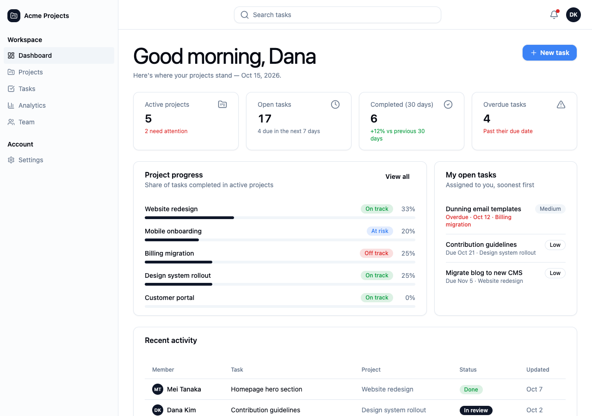
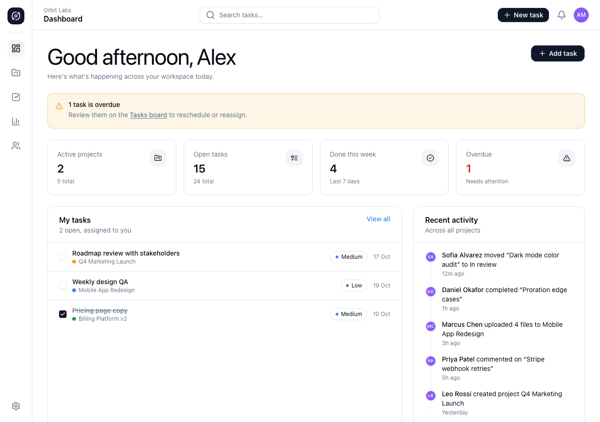
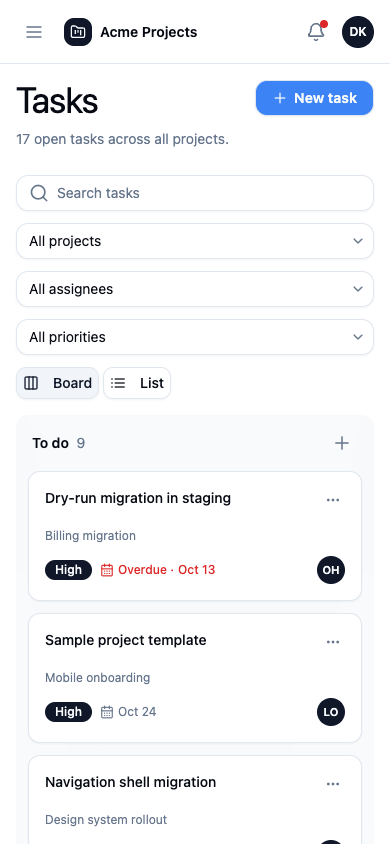
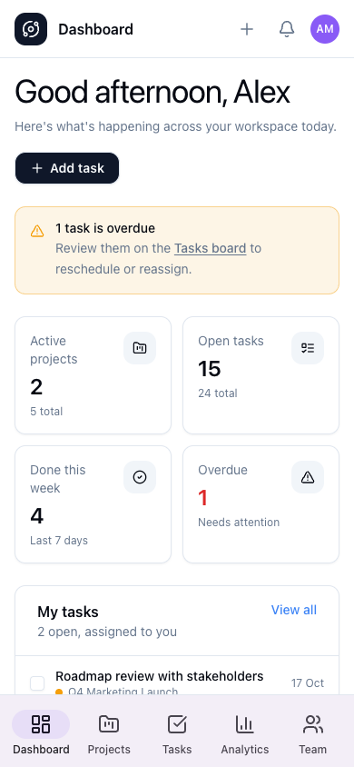

# Nucleux agent benchmark

Does Nucleux's agent tooling (the `nucleux` MCP server + the `nucleux-design`
skill) change what a coding agent builds? Each benchmark request runs twice in
identical fresh apps with the identical prompt; the only difference is the tooling.

| Arm | MCP server | Skill | What the agent can still read |
| --- | --- | --- | --- |
| `nucleux` | `nucleux` (this repo's `packages/mcp/dist`) | `nucleux-design` (via `init --claude`) | everything |
| `baseline` | none (`--strict-mcp-config` with an empty config) | none | the installed packages' `.d.ts`, READMEs and source in `node_modules` |

## Files

- `requests.json`: eight representative requests (project management, SaaS
  dashboard, e-commerce storefront, booking, admin panel, team management,
  settings/profile, data-heavy console) plus the shared prompt suffix.
- `run.mjs`: runs request × arm with headless Claude Code (`claude -p`, `dontAsk`
  permission mode with an allowlist, per-run budget cap), then scores.
- `score.mjs`: mechanical metrics for one app: `npm run build`, distinct
  `@nucleux` imports and any not in the catalog, raw HTML controls Nucleux
  ships (`<button>`, `<input>`, `<table>`…), hex/Tailwind-palette colors
  instead of tokens, responsive class count, and MCP tool calls from the
  session transcript.
- `responsive.mjs`: desktop + true 390px screenshots and horizontal-overflow
  check via `puppeteer-core` and a local Chrome.
- `results/`: recorded runs.

## Running it

```bash
pnpm build                                   # all packages + MCP server
# Template: a fresh Vite React-TS app with @nucleux/react + @nucleux/tokens
# installed (from npm, or from `pnpm -r pack` tarballs for an unpublished version).
node evals/run.mjs --template ../pm-template --out ../eval-runs --requests project-management --budget 15
```

Each run costs real API spend (about $3–4 per arm for the project-management
request with Claude Opus 5.5).

## Results: project management app, 2026-10-15

One request (`project-management`), one run per arm, Claude Code 2.1.300 with
`claude-opus-5-5`, fresh Vite 6 + React 19 + TypeScript app, Nucleux 0.5.0 from
local tarballs (Tailwind not set up; each agent had to do it). Raw data:
[`results/2026-10-15-project-management/`](results/2026-10-15-project-management/).

| | nucleux | baseline |
| --- | --- | --- |
| `npm run build` | passes | passes |
| `npm run lint` | clean | 0 errors, 4 warnings |
| Distinct `@nucleux` exports imported | 71 | 79 |
| Imports not in the catalog (invented) | 0 | 0 |
| Raw `<button>` / `<input>` / `<select>` / `<table>` / `<dialog>` | 3 / 0 / 0 / 0 / 0 | 1 / 0 / 0 / 0 / 0 |
| Hex colors in source (`index.css`/`*.tsx`) | 0 | 8 (custom chart palette) |
| Material Design 3 (`Md3*`) components mixed into the default theme | 0 | 5 |
| Loading skeletons (`<Skeleton>`) | 6 | 0 |
| Primary CTA variant (`variant="cta"`) used for the page action | 8 | 0 |
| `aria-label`s | 41 | 29 |
| Horizontal overflow at 390px (6 routes) | none | none |
| Turns / wall time / cost | 92 / 9.4 min / $3.21 | 118 / 15.3 min / $3.76 |
| MCP calls | `search_patterns` 1, `get_pattern` 5, `get_component` 26, `get_setup` 1, other 2 | — |

What the numbers do and don't show:

- **Both agents built a complete, working, responsive app.** With Opus 5.5,
  the baseline read the installed `.d.ts` files and invented no API. It also
  found the Tailwind `content` requirement by itself. On this request, "builds"
  and "uses real components" are not where the tooling made a difference.
- **The differences are design-system consistency and efficiency.** With the
  tooling, the agent used the curated patterns' structure (app shell with
  NavPanel + Sheet, list pages, KPI cards, settings tabs, page states), one
  `cta` primary action per page, token-only colors including charts, and
  skeleton loading states. The baseline mixed the separate Material Design 3
  component line into the default theme (an MD3 bottom navigation bar),
  defined its own hex chart palette, and has no loading skeletons. The tooling
  arm finished in 38% less wall time with 22% fewer turns and 15% lower cost.
- **This is one run per arm on one request.** Agent runs vary; treat this as
  a working end-to-end demonstration and a smoke test of the harness, not
  evidence of a general quality improvement. The remaining seven requests and
  repeated runs are needed before claiming one.

Screenshots (desktop dashboard, phone):

| nucleux | baseline |
| --- | --- |
|  |  |
|  |  |

Gaps the tooling arm reported (inputs for new patterns/components): no
task-card/kanban board, no menu-button (popover-triggered menu) component, and
no router integration guidance beyond `NavItem` + `preventDefault`.

## Codex

Codex is not installed on the machine these runs used, so no Codex arm has been
run. The integration (`codex mcp add`, `.agents/skills/nucleux-design`,
`AGENTS.md` section) follows OpenAI's documented conventions and is unit-tested
for file generation only.
