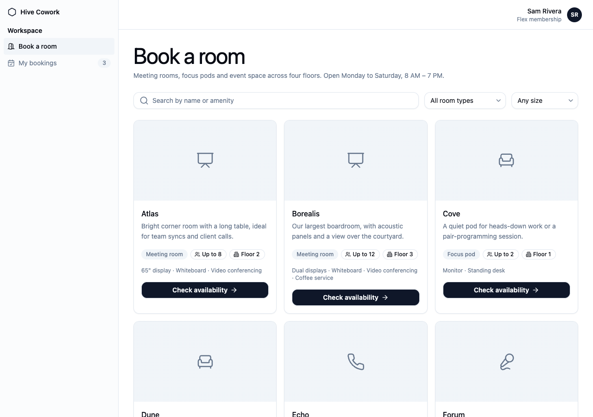
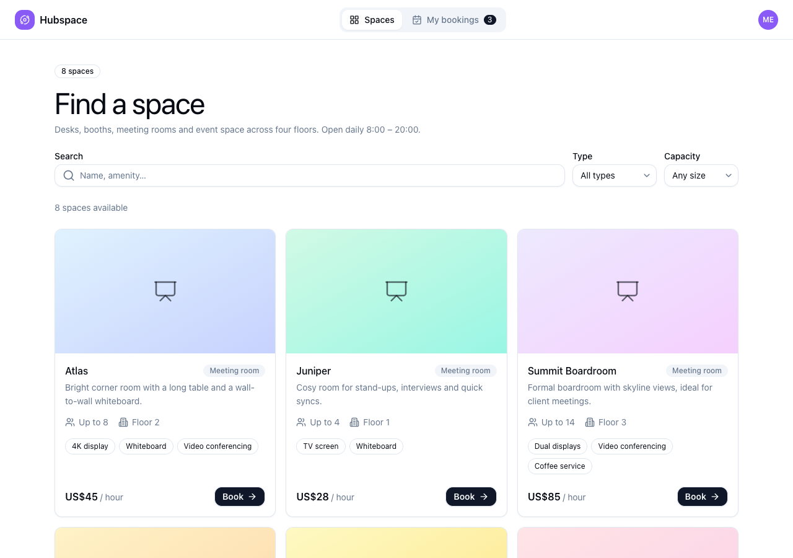
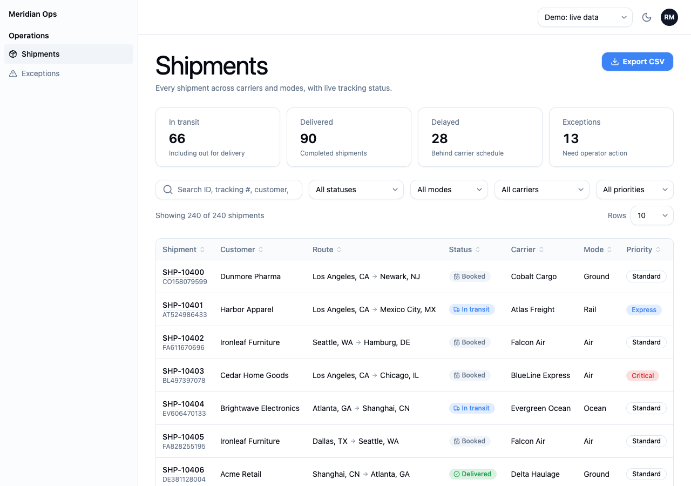
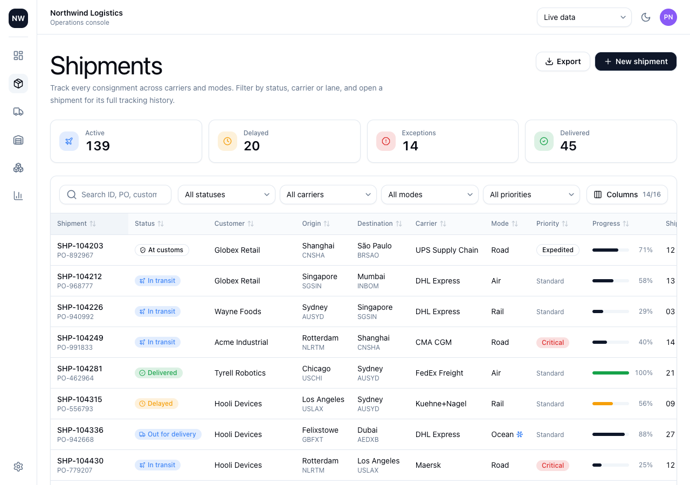

# Nucleux agent benchmark

Does Nucleux's agent tooling (the `nucleux` MCP server + the `nucleux-design`
skill) change what a coding agent builds? Each benchmark request runs twice in
identical fresh apps with the identical prompt; the only difference is the tooling.

| Arm | MCP server | Skill | What the agent can still read |
| --- | --- | --- | --- |
| `nucleux` | `nucleux` (this repo's `packages/mcp/dist`) | `nucleux-design` (via `init --claude`) | everything |
| `baseline` | none (`--strict-mcp-config` with an empty config) | none | the installed packages' `.d.ts`, READMEs and source in `node_modules` |

## Files

- `requests.json`: eight representative requests (project management, SaaS
  dashboard, e-commerce storefront, booking, admin panel, team management,
  settings/profile, data-heavy console) plus the shared prompt suffix.
- `run.mjs`: runs request × arm with headless Claude Code (`claude -p`, `dontAsk`
  permission mode with an allowlist, per-run budget cap), then scores.
- `score.mjs`: mechanical metrics for one app: `npm run build`, distinct
  `@nucleux` imports and any not in the catalog, raw HTML controls Nucleux
  ships (`<button>`, `<input>`, `<table>`…), hex/Tailwind-palette colors
  instead of tokens, responsive class count, and MCP tool calls from the
  session transcript.
- `responsive.mjs`: desktop + true 390px screenshots and horizontal-overflow
  check via `puppeteer-core` and a local Chrome.
- `results/`: recorded runs.

## Running it

```bash
pnpm build                                   # all packages + MCP server
# Template: a fresh Vite React-TS app with @nucleux/react + @nucleux/tokens
# installed (from npm, or from `pnpm -r pack` tarballs for an unpublished version).
node evals/run.mjs --template ../pm-template --out ../eval-runs --requests project-management --budget 15
```

Each run costs real API spend: $1.80–3.80 per run with Claude Opus 5.5 (about
$40 for all eight requests in both arms), 5–15 minutes each.

## Results: eight requests, 2026-10-15/16

> These results describe Nucleux 0.5.0. 0.6.0 renamed and replaced many components (see CHANGELOG.md); the benchmark has not been re-run on it.

All eight requests, one run per arm (16 runs), Claude Code 2.1.300 with
`claude-opus-5-5`, fresh Vite 6 + React 19 + TypeScript apps, Nucleux 0.5.0
from local tarballs (Tailwind not set up; each agent had to do it). The
`project-management` pair ran first with 5 curated patterns; the other seven
ran with 11 patterns and `validate_design`. Every app was rescored afterwards
with the same scorer and catalog. Raw data: [`results/2026-10-16-eight-requests/scores.json`](results/2026-10-16-eight-requests/scores.json)
(per run: metrics, MCP calls, the agent's own summary).

| Totals over 8 apps | nucleux | baseline |
| --- | --- | --- |
| `npm run build` passes | 8 / 8 | 8 / 8 |
| Imports of names not exported by Nucleux | 0 | 0 |
| Distinct Nucleux exports per app (mean) | 50.1 | 55.5 |
| Hand-rolled controls Nucleux ships (`<button>`, `<input>`, `<table>`…) | 4, in 2 apps | 11, in 5 apps |
| Tailwind palette colors instead of tokens | 0 | 16, in 1 app |
| Hex colors (excluding the Vite template's unused `App.css`) | 0 | 9, in 1 app |
| Material Design 3 components mixed into the default theme | 0 apps | 1 app |
| Apps with loading skeletons | 8 | 1 |
| Apps with empty/error states (`ErrorState`) | 8 | 6 |
| Horizontal overflow on the home screen at 390px | 0 apps | 0 apps |
| Responsive class prefixes (`sm:`…`xl:`) | 358 | 378 |
| Wall time / cost / turns | 59.0 min / $19.57 / 639 | 70.0 min / $20.37 / 679 |
| Faster / cheaper on a request | 5 of 8 / 4 of 8 | 3 of 8 / 4 of 8 |
| MCP calls | 270 (39 `get_pattern`; `validate_design` in all 7 runs that had it) | — |

Per request:

| Request | Arm | Imports | Hand-rolled | Off-token colors | Skeleton / ErrorState | Min | Cost |
| --- | --- | --- | --- | --- | --- | --- | --- |
| project-management | nucleux | 71 | 3 | 0 | 6 / 2 | 9.4 | $3.21 |
| | baseline | 79 | 1 | 9 hex, 2 MD3 components | 0 / 4 | 15.3 | $3.76 |
| saas-dashboard | nucleux | 52 | 0 | 0 | 4 / 2 | 5.1 | $1.99 |
| | baseline | 56 | 2 | 0 | 0 / 0 | 5.6 | $1.82 |
| ecommerce-storefront | nucleux | 43 | 0 | 0 | 13 / 8 | 9.3 | $3.04 |
| | baseline | 52 | 0 | 0 | 0 / 6 | 8.5 | $3.05 |
| booking-app | nucleux | 47 | 0 | 0 | 9 / 6 | 6.0 | $2.31 |
| | baseline | 37 | 0 | 16 palette | 0 / 2 | 5.4 | $1.85 |
| admin-panel | nucleux | 53 | 0 | 0 | 10 / 6 | 7.0 | $2.32 |
| | baseline | 53 | 2 | 0 | 0 / 3 | 9.1 | $2.70 |
| team-management | nucleux | 47 | 0 | 0 | 13 / 8 | 6.5 | $2.45 |
| | baseline | 58 | 0 | 0 | 0 / 6 | 9.2 | $2.30 |
| settings-profile | nucleux | 49 | 1 | 0 | 4 / 5 | 9.8 | $2.44 |
| | baseline | 50 | 2 | 0 | 0 / 0 | 7.3 | $2.09 |
| data-heavy | nucleux | 39 | 0 | 0 | 13 / 4 | 5.9 | $1.81 |
| | baseline | 59 | 4 | 0 | 16 / 5 | 9.6 | $2.80 |

### What this shows

- **Correctness is not where the tooling helps with this model.** Both arms
  built all eight apps, every build passed, and neither invented a Nucleux
  API. Claude Opus 5.5 reads the installed `.d.ts` files well enough on its
  own, and the baseline even discovered the Tailwind `content` requirement
  itself.
- **The tooling consistently changes design-system adherence.** With it,
  every app handled loading (8/8 vs 1/8 with skeletons) and empty/error states
  (8/8 vs 6/8), stayed on tokens (no palette or hex colors, no MD3 components
  mixed in; the baseline did one or the other in 2 apps), and hand-rolled
  fewer controls Nucleux already ships (4 vs 11). These follow directly from
  the pattern and workflow rules, and they held in every run.
- **The baseline used slightly more of the library and built richer pages
  in places.** It averaged more distinct components (55.5 vs 50.1) and, for
  example, gave the logistics console a column picker and colored KPI icons
  (screenshots below). The tooling arm's apps all share the `app-shell`
  layout: consistent, but less varied from product to product.
- **Speed and cost are a wash.** 16% less total wall time and 4% lower total
  cost with the tooling, but it was faster on only 5 of 8 requests and
  cheaper on 4 of 8. With one run per cell, that is within run-to-run noise.
- **Limits.** One run per request and arm, one model, mechanical metrics
  (counts, builds, overflow) plus spot-checked screenshots, no human design
  rating. Repeated runs and a blind design review would be needed to claim a
  general quality improvement; what is supported is the adherence effect above.

Booking app (left: nucleux, right: baseline). The baseline's pastel card
headers are raw Tailwind palette gradients:

| nucleux | baseline |
| --- | --- |
|  |  |
|  |  |

The first pair's write-up and screenshots are in
[`results/2026-10-15-project-management/`](results/2026-10-15-project-management/).
Gaps that run's agent reported (task board, menu button, router guidance)
became the `task-board` pattern and the `app-shell` routing notes.

## Codex

Codex is not installed on the machine these runs used, so no Codex arm has been
run. The integration (`codex mcp add`, `.agents/skills/nucleux-design`,
`AGENTS.md` section) follows OpenAI's documented conventions and is unit-tested
for file generation only.
